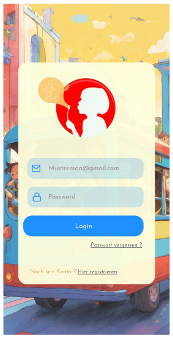
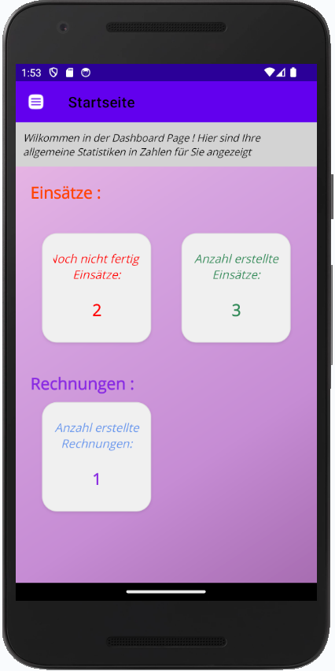
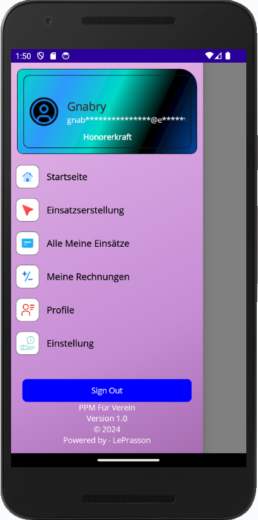
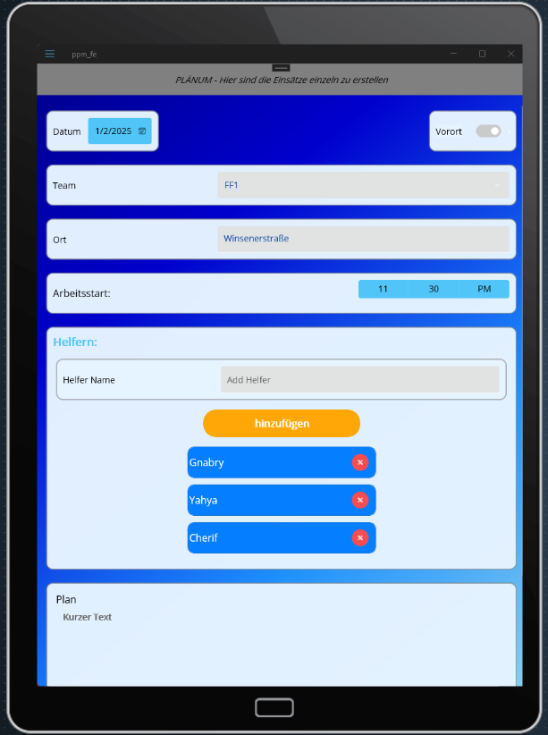
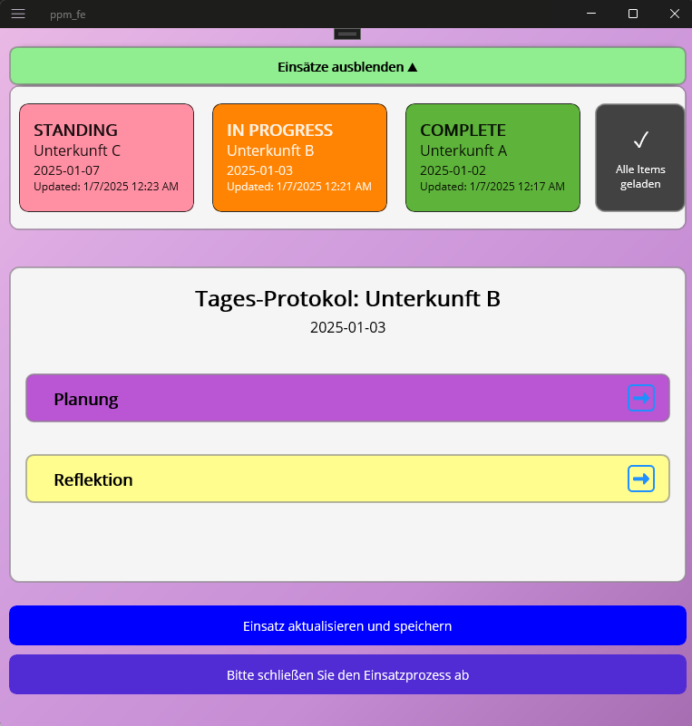
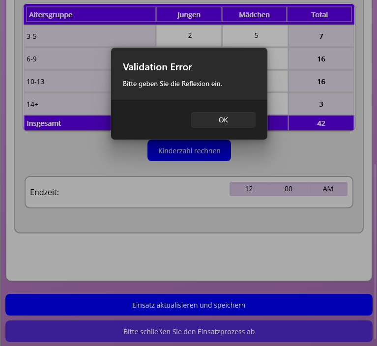

# PPM für Verein – .NET MAUI App

Plattformübergreifende App (Windows, Android) für die Vereinsverwaltung: Arbeitseinträge, Abrechnung und Statistiken. Entstanden als Bachelorarbeit an der Hochschule Flensburg (2025) mit .NET MAUI 8 und MVVM. Prototyp.

## Screenshots

**Android**

<table>
  <tr>
    <td align="center"><br><sub>Login</sub></td>
    <td align="center"><br><sub>Startseite mit Statistik</sub></td>
    <td align="center"><br><sub>Menü für die Rolle Honorarkraft</sub></td>
  </tr>
</table>

**Windows**

<table>
  <tr>
    <td align="center"><br><sub>Einsatz erstellen</sub></td>
    <td align="center"><br><sub>Einsatzliste und Tages-Protokoll</sub></td>
    <td align="center"><br><sub>Kinderzahl-Statistik, Pflichtfeld-Validierung</sub></td>
  </tr>
</table>

## Funktionen

- **Plattformübergreifend**: Windows und Android (iOS- und MacCatalyst-Ordner stammen aus dem Template und sind ungetestet)
- **Eigene Oberfläche**: Benutzerdefinierte Komponenten und Layouts für Smartphone- und Desktop-Fenster
- **Rollenbasierte Menüs und Startseiten**: Admin, Festmitarbeiter, Honorarkraft
- **Einsatzplanung**: Einsätze mit Datum, Team, Ort, Arbeitsstart, Helfern und Plantext anlegen
- **Einsatzverwaltung**: Einsatzliste mit Status (Standing, In Progress, Complete) und Tages-Protokoll mit Planung und Reflexion
- **Kinderzahl-Statistik**: Auswertung nach Altersgruppe und Geschlecht mit Summen und Pflichtfeld-Validierung
- **Dashboard-Analysen**: Kennzahlen und interaktive Diagramme mit LiveChartsCore
- **Rechnungen**: Erstellen und Einsehen von Rechnungen
- **PDF-Erstellung**: Dokumente mit iText7
- **Theme-Unterstützung**: Mehrere Design-Themes mit dynamischem Wechsel
- **Benutzerdefinierte Steuerelemente**: Wiederverwendbare Komponenten wie `LabeledEntry`, `CustomButton`, `EditableLabel`
- **Anmeldung und Profil**: Login, Registrierung und Profilverwaltung gegen eine REST-API

## 🛠️ Technologiestack

- **Framework**: .NET MAUI 8.0
- **Architektur**: MVVM (Model-View-ViewModel)
- **UI-Komponenten**: 
  - CommunityToolkit.Maui
  - UraniumUI.Material
  - Custom XAML controls
- **Datenvisualisierung**: LiveChartsCore.SkiaSharpView
- **PDF-Verarbeitung**: iText7
- **Zustandsverwaltung**: CommunityToolkit.Mvvm
- **Styling**: Benutzerdefinierte Themes mit dynamischem Ressourcenmanagement

## 📱 Unterstützte Plattformen
- Getestet: Windows und Android. Die Plattformordner für iOS, MacCatalyst und Tizen stammen aus dem MAUI-Template und wurden nicht getestet.
- Android (API Level 21+)
- Windows 10 (10.0.17763.0+)

## 🏗️ Projektstruktur

```
ppm-fe/
├── Controls/        # Benutzerdefinierte UI-Steuerelemente
├── Models/          # Datenmodelle
├── ViewModels/      # ViewModels für MVVM
├── Views/           # UI-Seiten und Layouts
├── Services/        # Geschäftslogik und Dienste
├── Resources/       # Bilder, Schriftarten und Themes
├── Helpers/         # Hilfsklassen
└── Extensions/      # Erweiterungsmethoden
```

## 🚀 Starten

Voraussetzungen: .NET 8 SDK, Visual Studio 2022 mit MAUI-Workload.
Die App benötigt die zugehörige REST-API (nicht Teil dieses Repositorys). Die Basisadresse steht in Helpers/RouteHelper.cs.
Projekt in Visual Studio öffnen, als Ziel „Windows Machine“ oder einen Android-Emulator wählen und starten.

## Architektur

- MVVM mit CommunityToolkit.Mvvm: 17 ViewModels, [ObservableProperty], AsyncRelayCommand, WeakReferenceMessenger für die Kommunikation zwischen Seiten
- Shell-Navigation, Menüs abhängig von der Benutzerrolle
- Dependency Injection in MauiProgram.cs: Services hinter Interfaces (Auth, Work, Billing, Cache, Connectivity, LocalPath)
- REST-Zugriff über HttpClient, teilweise mit Zwischenspeicher (CacheService)
- Ein Behavior und 22 Value-Converter-Dateien

## 📦 Technologien und Abhängigkeiten (Dependencies)

.NET MAUI 8 · CommunityToolkit.Mvvm 8.2.2 · CommunityToolkit.Maui 9.0.3 · UraniumUI.Material 2.9.1 · LiveChartsCore.SkiaSharpView.Maui 2.0.0-rc4.5 · itext7 8.0.5

## Bekannte Einschränkungen (Prototyp)

- Die API-Anbindung lief im Prototyp ohne HTTPS. Für den produktiven Einsatz: TLS erzwingen, Basisadresse aus der Konfiguration laden.
- Die Passwort-Verarbeitung liegt im Backend und ist nicht Teil dieses Repositorys.
- Keine automatisierten Tests.

## Weiterentwicklung

Die Anwendung wurde als Webanwendung neu umgesetzt: ppm-backend (.NET 10) und ppm-frontend (Next.js), siehe github.com/djzh23.

---

Mit ❤️ entwickelt mit .NET MAUI
